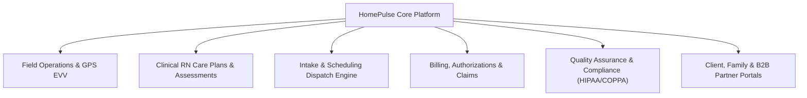
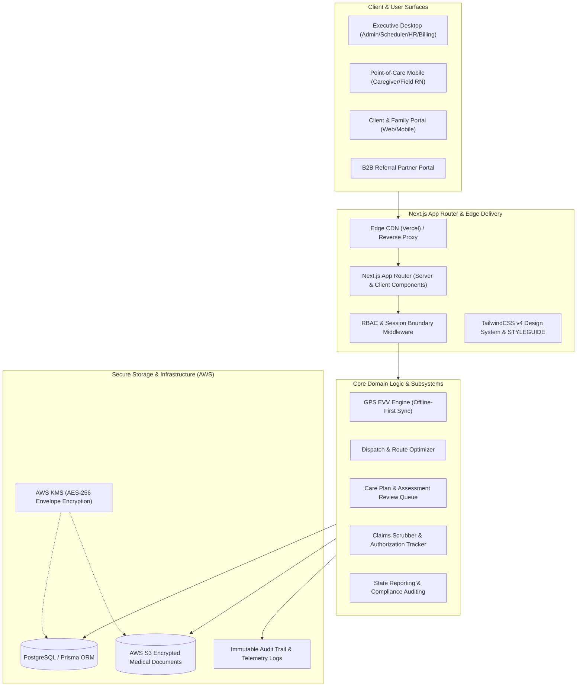
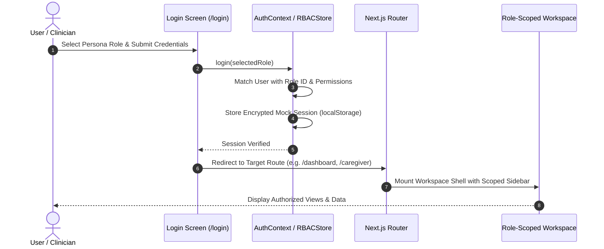

# HomePulse — Enterprise System Architecture

> **Document:** Platform Architecture & Technical Blueprint  
> **Version:** 2.0  
> **Status:** Active / Production-Ready  
> **Frameworks:** Next.js (App Router), React 19, TypeScript, TailwindCSS v4, Framer Motion  
> **Regulatory Adherence:** HIPAA Security & Privacy Rules, COPPA Children's Privacy Standard  

---

## 1. Executive Summary & Platform Vision

**HomePulse** is a mission-critical healthcare enterprise platform engineered to streamline the full lifecycle of home health care operations. It bridges field operations, clinical care, administrative governance, billing compliance, and patient-family engagement into a unified, secure system.



---

## 2. High-Level System Architecture

The application adopts a modern, modular cloud architecture optimized for fast edge delivery, strict role-based access isolation, and zero-leakage data governance.



---

## 3. Information Architecture (IA) & Route Topology

Per workspace guidelines, HomePulse maintains a strict Information Architecture: every page is logically mapped to specific personas, avoiding duplicate views, redundant workflows, or overlapping responsibilities.

```
homepulse/
├── src/app/
│   ├── admin/                    # Executive Command Center & Governance
│   │   └── command-center/       # High-density operational telemetry & KPIs
│   ├── intake/                   # Referral & Patient Intake Pipeline
│   │   ├── dashboard/            # Intake metrics & urgency queues
│   │   ├── referrals/            # Active referral triage
│   │   ├── scheduling/           # Initial assessment dispatch
│   │   ├── patients/             # Pre-admission roster
│   │   └── reports/              # Intake conversion analytics
│   ├── scheduler/                # Dispatch & Shift Board Management
│   │   ├── board/                # Drag-and-drop shift calendar
│   │   ├── tracker/              # Caregiver live GPS dispatch map
│   │   ├── caregivers/           # Caregiver availability matrices
│   │   └── dispatch/optimizer/   # Route & travel-time optimization
│   ├── clinical/                 # RN Clinical Oversight & Case Management
│   │   ├── assessments/          # OASIS, initial, and periodic care plans
│   │   ├── incidents/            # Clinical triage for condition changes & falls
│   │   └── qa/                   # Clinical audit queues
│   ├── caregiver/                # Mobile-First Point-of-Care Portal
│   │   ├── today/                # Daily visit itinerary & GPS clock-in/out
│   │   ├── schedule/             # Shift claiming & upcoming calendar
│   │   ├── training/             # Assigned LMS modules
│   │   └── profile/              # Certifications & documentation
│   ├── compliance/               # QA & Regulatory Oversight
│   │   ├── tracking/             # 9 Tracked compliance domains
│   │   ├── incidents/            # Unscoped restricted incident investigations
│   │   └── reports/              # State survey readiness metrics
│   ├── billing/                  # Financial Administration & Claims
│   │   ├── workspace/            # EVV verification & claims scrubber
│   │   ├── authorizations/       # Payor unit & expiration countdown
│   │   ├── payroll/              # Caregiver hourly timesheets
│   │   └── reports/              # Revenue cycle management (RCM)
│   ├── hr/                       # Staff Recruiting & Credentialing
│   │   ├── recruiting/           # Caregiver onboarding pipeline
│   │   ├── caregivers/           # Active roster, CPR/CNA renewals
│   │   └── training/             # LMS administration
│   ├── portal/                   # Self-Service Patient & Family Portal
│   │   ├── visits/               # Caregiver arrival logs & visit history
│   │   ├── care-plan/            # Active goals & ADL/IADL transparency
│   │   ├── billing/              # Patient statements & co-pays
│   │   └── messages/             # Direct secure line to care team
│   ├── partner/                  # External Hospital & Physician Portal
│   │   ├── submit/               # Encrypted referral submission form
│   │   └── referrals/            # Status tracking (admitted, pending, rejected)
│   ├── styleguide/               # Design System, Component & Layout Explorer
│   └── login/                    # Multi-Persona Role-Switching Authentication
```

---

## 4. Role-Based Access Control (RBAC) Architecture

HomePulse employs a multi-tiered Principle of Least Privilege (PoLP) model. Users only see and interact with data strictly required for their operational duties.

### Role Matrix

| Role Key | Scope & Persona | Primary Portals & Capabilities |
| :--- | :--- | :--- |
| `ADMIN` | Executive Governance | Full agency command center, financial metrics, branch management, global user administration. |
| `SCHEDULER` | Dispatcher | Shift scheduling board, caregiver availability tracking, route optimizer, visit reassignment. |
| `HR` | Talent & Recruiter | Caregiver roster, onboarding pipeline, background checks, license renewal monitoring, timesheet approvals. |
| `CAREGIVER` | Field Care Professional | Mobile itinerary, GPS EVV clock-in/out, care task checklists, vitals entry, incident filing. |
| `CLIENT` | Patient | Personal care plan, upcoming caregiver visits, billing receipts, secure messaging with clinical team. |
| `FAMILY` | Authorized Guardian | Transparent visit monitoring, caregiver arrival confirmations, care plan feedback, billing portal. |
| `INTAKE_COORDINATOR` | Referral Manager | Partner referral triage, eligibility checks, document intake, admission scheduling. |
| `BILLING_FINANCE_STAFF` | Billing Specialist | Claims generation, EVV scrub checks, payor authorizations, claims dispute resolution, payroll. |
| `CLINICAL_SUPERVISOR_RN` | Registered Nurse | Comprehensive assessments, care plan reviews, condition change escalation, medication orders. |
| `QA_COMPLIANCE_OFFICER` | Compliance Auditor | State reporting deadline tracking, unrestricted incident investigations, mock survey prep. |
| `FIELD_SUPERVISOR` | Field Operations RN | On-site caregiver performance reviews, quarterly supervisory visits, field incident triage. |
| `PARTNER` | Physician / Hospital | Secure referral submission, real-time admission confirmation, document upload. |
| `TRAINER` | LMS Administrator | Healthcare course builder, quiz configuration, certification tracking. |

### Authentication & RBAC Flow



---

## 5. Core Technical Subsystems

### 1. Electronic Visit Verification (EVV) & Geofencing
To comply with the 21st Century Cures Act, HomePulse enforces GPS-verified visit logging:
- **Geofence Calculation**: Uses the Haversine formula to compute the caregiver's distance to the client's home coordinates.
- **Verification Threshold**: Visits within `< 100 meters` are tagged `VERIFIED_GPS`.
- **Offline-First Synchronization**: If the field caregiver loses mobile signal, visits are timestamped and signed with a cryptographic HMAC, stored in IndexedDB/LocalCache, and synced automatically when network connectivity resumes.

### 2. Clinical Care Plan Review & Escalation Pipeline
- **Continuous Oversight**: Tracks periodic review intervals (30-day, 60-day recertification windows).
- **Incident-Triggered Reassessment**: Whenever a caregiver submits a Fall or Condition Change report, the system automatically triggers a Clinical RN Review ticket with elevated urgency.

### 3. Claims Scrubber & Payor Authorization Engine
- **Pre-Billing Scrubber**: Before converting shifts into 837 claims, the system validates:
  1. Verified EVV clock-in and clock-out timestamps exist.
  2. Patient has active payor authorization units remaining.
  3. Caregiver held active credentials during visit time.
- **Authorization Depletion Countdown**: Warns billing coordinators 14 days before units expire.

### 4. Regulatory State Deadline Countdown (QA)
- Proactive timers for state-reportable critical incidents (e.g., 24-hour initial notice, 5-day formal investigation report), preventing state survey citations.

---

## 6. Frontend Architecture & Design System

The frontend is built according to [STYLEGUIDE.md](file:///f:/Project-Personal-Portfolio/homepulse/STYLEGUIDE.md):

```mermaid
graph LR
    subgraph UI_Architecture ["UI & Styling Architecture"]
        Tailwind["TailwindCSS v4 (@theme tokens)"]
        Framer["Framer Motion (Transitions & Gestures)"]
        Lucide["Lucide Icons (Semantic Iconography)"]
        Sonner["Sonner (Accessible Toast Notifications)"]
    end

    subgraph Design_System ["Components & Primitives"]
        Logo["<HomePulseLogo /> (Scalable Vector Mark)"]
        Card["<Card /> (Glassmorphic Elevated Container)"]
        Badge["<Badge /> (Status Pills with Severity Colors)"]
        Modal["<Modal /> (Accessible Dialogs with Focus Trap)"]
    end

    subgraph Layout_System ["Better Layout Patterns"]
        Split["70/30 Command Split Layout"]
        KPIGrid["4-Column Responsive Metric Grid"]
        MasterDetail["Master-Detail Inspection Pane"]
        FormLayout["Grouped Fieldset & Sticky Action Bar"]
    end

    UI_Architecture --> Design_System
    Design_System --> Layout_System
```



### Component Structure Rules
- **Pure Vector Brand Components**: Use `HomePulseLogo.tsx` with `variant="horizontal" | "icon-only" | "stacked"`.
- **Layout Consistency**: TopBar + Sidebar Shell (`AppLayout.tsx`) encapsulates child views.
- **Glassmorphism Standard**: `bg-white/80 backdrop-blur-xl border border-slate-200/80 shadow-[0_6px_32px_rgba(0,0,0,0.04)]`.

---

## 7. Compliance & Security Architecture

### HIPAA Compliance (Health Insurance Portability and Accountability Act)
1. **Encryption Standards**:
   - Data at Rest: AES-256 encryption across PostgreSQL databases and AWS S3 document buckets.
   - Data in Transit: Enforced TLS 1.3 encryption across all client-server endpoints.
2. **Access Control & Minimal Disclosure**:
   - Access to client health records is restricted to caregivers assigned to that specific client.
   - Administrative logs never print Protected Health Information (PHI) or Personally Identifiable Information (PII).
3. **Audit Trails**:
   - Immutable audit logs capture user ID, timestamp, IP address, and operation (`VIEW`, `CREATE`, `UPDATE`, `DELETE`) for all medical documents.

### COPPA Compliance (Children's Online Privacy Protection Act)
When processing records for pediatric patients under 13:
- **Verifiable Parental Consent (VPC)**: The system requires signed guardian consent prior to data collection.
- **Data Fencing**: Pediatric records are isolated and strictly blocked from third-party marketing brokers or analytics trackers.
- **Parental Review & Expungement**: Parents retain real-time portal access to inspect and request deletion of their child's records.

---

## 8. Directory Structure & Codebase Organization

```
homepulse/
├── public/                     # Static assets, favicons, vector marks
├── src/
│   ├── app/                    # Next.js App Router routes & page views
│   ├── components/             # Reusable UI component modules
│   │   ├── brand/              # HomePulseLogo and brand vectors
│   │   ├── layout/             # Sidebar, TopBar, AppLayout, GlobalSearch
│   │   ├── ui/                 # Card, Badge, Modal, Avatar, ProgressBar
│   │   ├── caregiver/          # Caregiver point-of-care widgets
│   │   ├── clinical/           # RN assessment forms & queues
│   │   ├── compliance/         # QA audit components & checklists
│   │   ├── dispatch/           # Scheduling & shift board components
│   │   ├── intake/             # Referral triage & eligibility forms
│   │   ├── partner/            # Referral submission & status boards
│   │   ├── rbac/               # User permissions & role switchers
│   │   └── tracker/            # Live caregiver GPS tracking map
│   ├── hooks/                  # Custom React hooks (useAuth, useSidebarCollapse)
│   ├── lib/                    # Core business logic, mock data stores, RBAC
│   └── types/                  # TypeScript interfaces, RBAC types, API schemas
├── AGENTS.md                   # Custom agent workflow rules
├── ARCHITECTURE.md             # This document — System Architecture Blueprint
├── README.md                   # Project overview & getting started guide
├── RULES.md                    # Infrastructure & compliance rules
└── STYLEGUIDE.md               # UI tokens, color palettes & layout standards
```

---

## 9. Verification & Architectural Governance

- **CI/CD Quality Gates**: Automated static type-checking (`tsc --noEmit`), linting (`eslint`), and security scanning.
- **Code Review Mandate**: All pull requests require at least one peer review confirming adherence to `RULES.md` and `STYLEGUIDE.md`.
- **Architectural Reference**: For styling standards, see [STYLEGUIDE.md](file:///f:/Project-Personal-Portfolio/homepulse/STYLEGUIDE.md). For compliance rules, see [RULES.md](file:///f:/Project-Personal-Portfolio/homepulse/RULES.md).
